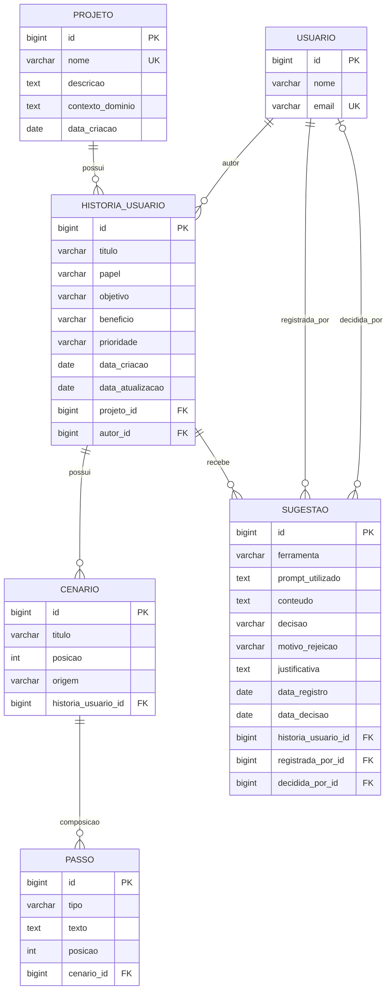

# Estúdio BDD

Aplicação para elaborar a **documentação de requisitos** de um sistema. Nela são registradas **histórias de usuário** e seus critérios de aceite, escritos como **cenários BDD** (Dado / Quando / Então). Também são registradas as **sugestões de melhoria obtidas com ferramentas de IA**, que o analista aceita ou rejeita (com motivo). Ao final, as histórias podem ser exportadas como arquivos `.feature` (Gherkin em português).

Projeto da disciplina **Programação de Sistemas II** · Projeto 2026/2.

---

## Integrantes

| Nome | RA |
|---|---|
| _Luana de Paiva Brito_ | _10750121_ |
| _Louisy Dalchiavon Tomazi_ | _10755895_ |


---

## Tecnologias

- Java 17
- Spring Boot 3 (Web, Data JPA, Validation)
- Lombok
- PostgreSQL
- JUnit 5, Mockito e ArchUnit (testes)
- Maven
- React
- Typescript
- Vite (build)
- React Router
- CSS3

## Estrutura da API

```
br.com.projeto.estudioBDD
├── config            carga de dados fictícios (CarregadorDadosFicticios)
├── controller        endpoints REST (só recebem/devolvem DTOs e chamam services)
├── dto               objetos de entrada e saída da API
├── service           regras de negócio
├── exception         RegraNegocioException e tratamento global de erros
└── database
    |── model         entidades JPA e enums
    |    └──enums
    └── repository    interfaces Spring Data
```

Regra de arquitetura (verificada com ArchUnit): **controllers não acessam repositories**.

## Estrutura do SPA (Frontend)

```
frontend/src
├── assets            recursos estáticos e mídias da interface
├── components        componentes reutilizáveis de UI (ex.: ModalAviso, cabeçalho e badges)
├── contexts          gerenciamento de estado global e sessão do usuário (usuarioContext)
├── pages             telas principais e fluxos de navegação (Login, Projetos, Detalhes e Estúdio)
├── services          camada de comunicação HTTP com os endpoints REST da API
├── types             interfaces e tipagens TypeScript dos modelos de requisição e resposta
├── App.tsx           configuração das rotas e estrutura base da aplicação
├── App.css           estilos globais dos componentes e layouts da aplicação
├── main.tsx          ponto de entrada que inicializa o React no DOM
└── index.css         redefinições e variáveis de estilo base
```

Regra de arquitetura (separação de responsabilidades): **pages e components não realizam chamadas HTTP diretas — toda comunicação com a API passa pela camada de `services`**.

---


## Como executar

### Pré-requisitos

- JDK 17+
- Maven 3.9+ (ou o `mvnw` do projeto)
- O banco utilizado foi o PostgreSQL 14+
- Node.js 18+ e npm (para executar o SPA)

### 1. Subir o banco de dados

crie o banco manualmente:

```sql
CREATE DATABASE estudiobdd;
```

### 2. Configurar a aplicação

Em `src/main/resources/application.yml`:

```yaml
spring:
  datasource:
    url: SUA_URL_BD
    username: SEU_USUARIO
    password: SUA_SENHA
    driver-class-name: org.postgresql.Driver
  jpa:
    hibernate:
      ddl-auto: update   # cria/atualiza as tabelas e sequences automaticamente

app:
  seed:
    ativo: true         # true carrega os dados fictícios ao iniciar (veja a seção abaixo)
```

### 3. Rodar a API

```bash
mvn spring-boot:run
```

A API sobe em `http://localhost:8080`. Para conferir:

```
GET http://localhost:8080/api/projetos
```

### 4. Rodar os testes

```bash
mvn test
```

Executa o teste de arquitetura (ArchUnit) e os testes das regras de negócio:

- cenário sem passo **Então** é rejeitado;
- rejeição de sugestão **sem motivo** é recusada;
- exportação **bloqueada** com sugestão pendente;
- **controllers não acessam repositories**.

### 5. Rodar o SPA (Frontend)

Com a API em execução na porta `8080`, acesse a pasta `frontend`, instale as dependências e inicie o servidor de desenvolvimento:

```bash
cd frontend
npm install
npm run dev
```

A aplicação web sobe em `http://localhost:5173`.

---

## Dados fictícios

Ao subir a aplicação com a propriedade ligada, a classe `CarregadorDadosFicticios` cria usuários, projetos, histórias, cenários e sugestões de exemplo. Ela usa os serviços da API, então as regras de negócio também valem para a carga.

```yaml
app:
  seed:
    ativo: true
```

Depois que os dados estiverem no banco, volte para `ativo: false`. A carga **não duplica**: se o projeto já tem histórias, ele é ignorado.

### Usuários

| Id | Nome | E-mail |
|---|---|---|
| 1 | Ana Analista | ana@exemplo.com |
| 2 | Bruno Barros | bruno@exemplo.com |
| 3 | Carla Costa | carla@exemplo.com |
| 4 | Diego Dias | diego@exemplo.com |

### Projetos

| Id | Nome |
|---|---|
| 1 | Estúdio BDD |
| 2 | Estoque de Crochê |

### Histórias, cenários e sugestões

| Id | Projeto | História | Prioridade | Autor | Cenários | Sugestões |
|---|---|---|---|---|---|---|
| 1 | Estúdio BDD | Cadastro de cenários | ALTA | Ana | 4 (1 de origem `SUGESTAO_IA`) | 3 decididas: 1 aceita, 1 `GENERICA`, 1 `DUPLICADA` |
| 2 | Estúdio BDD | Registro de sugestões de IA | ALTA | Bruno | 4 | 2 rejeitadas (`INCORRETA`, `FORA_DO_ESCOPO`) e 1 pendente |
| 3 | Estúdio BDD | Exportação do arquivo .feature | MEDIA | Carla | 3 | 2 pendentes |
| 4 | Estúdio BDD | Consulta de projeto (regra 6) | MEDIA | Ana | 3 | nenhuma |
| 5 | Estúdio BDD | Resumo do projeto | BAIXA | Bruno | 2 | nenhuma |
| 6 | Estoque de Crochê | Cadastro de novelo | ALTA | Diego | 2 | 1 pendente |
| 7 | Estoque de Crochê | Baixa de material em uma peça | MEDIA | Diego | 2 | 1 rejeitada (`GENERICA`) |
| 8 | Estoque de Crochê | Alerta de estoque baixo | BAIXA | Carla | 2 | nenhuma |

> Os ids acima valem para um banco vazio (ids em ordem de criação).

**Resultados esperados para conferência:**

- `GET /api/projetos/1/historias?prioridade=ALTA` retorna 2 histórias; `MEDIA`, 2; `BAIXA`, 1.
- `GET /api/projetos/1/resumo`: 5 histórias; cenários 15 `HUMANO` e 1 `SUGESTAO_IA`; sugestões 3 `PENDENTE`, 1 `ACEITA` e 4 `REJEITADA`.
- Exportação `.feature` funciona para as histórias **1, 4, 5, 7 e 8** e retorna **422** para **2, 3 e 6** (sugestões pendentes).


---

## Diagrama de classes



### Valores dos enums (gravados como texto)

| Campo | Valores |
|---|---|
| `prioridade` | `ALTA`, `MEDIA`, `BAIXA` |
| `origem` (cenário) | `HUMANO`, `SUGESTAO_IA` |
| `tipo` (passo) | `DADO`, `QUANDO`, `ENTAO`, `E`, `MAS` |
| `decisao` | `PENDENTE`, `ACEITA`, `REJEITADA` |
| `motivo_rejeicao` | `INCORRETA`, `GENERICA`, `DUPLICADA`, `FORA_DO_ESCOPO`, `OUTRO` |

---

## Documentação dos endpoints

Base: `http://localhost:8080`. Corpo e respostas em JSON (`Content-Type: application/json`).

- **Identificação do usuário:** as operações de escrita sobre histórias, cenários e sugestões exigem o cabeçalho `X-Usuario-Id` com o id do usuário


### Resumo

| Método | Rota | Cabeçalho | Descrição | Sucesso |
|---|---|---|---|---|
| POST | `/api/usuarios` | | Cria usuário | 201 |
| GET | `/api/usuarios` | | Lista usuários | 200 |
| GET | `/api/usuarios/{id}` | | Busca usuário | 200 |
| POST | `/api/projetos` | | Cria projeto | 201 |
| GET | `/api/projetos` | | Lista projetos | 200 |
| GET | `/api/projetos/{id}` | | Busca projeto | 200 |
| GET | `/api/projetos/{id}/resumo` | | Resumo do projeto (regra 7) | 200 |
| POST | `/api/projetos/{projetoId}/historias` | `X-Usuario-Id` | Cria história (quem envia vira o autor) | 201 |
| GET | `/api/projetos/{projetoId}/historias` | | Lista histórias com contagens; filtro `?prioridade=` (regra 6) | 200 |
| GET | `/api/historias/{id}` | | Busca história com cenários e passos | 200 |
| PUT | `/api/historias/{id}` | `X-Usuario-Id` | Atualiza história (só o autor) | 200 |
| DELETE | `/api/historias/{id}` | `X-Usuario-Id` | Exclui história, cenários e sugestões (só o autor) | 204 |
| GET | `/api/historias/{id}/feature` | | Exporta o arquivo `.feature` (regra 5) | 200 |
| POST | `/api/historias/{historiaId}/cenarios` | `X-Usuario-Id` | Cria cenário (só o autor) | 201 |
| GET | `/api/historias/{historiaId}/cenarios` | | Lista cenários da história | 200 |
| PUT | `/api/cenarios/{id}` | `X-Usuario-Id` | Atualiza cenário e substitui os passos (só o autor) | 200 |
| DELETE | `/api/cenarios/{id}` | `X-Usuario-Id` | Exclui cenário e renumera as posições (só o autor) | 204 |
| POST | `/api/historias/{historiaId}/sugestoes` | `X-Usuario-Id` | Registra sugestão (nasce `PENDENTE`) | 201 |
| GET | `/api/historias/{historiaId}/sugestoes` | | Lista sugestões; filtro `?decisao=` | 200 |
| PUT | `/api/sugestoes/{id}/decisao` | `X-Usuario-Id` | Aceita ou rejeita a sugestão | 200 |

---

### Regras de negócio

| Regra | Onde é aplicada |
|---|---|
| 1. E-mail, nome do projeto, título da história (no projeto) e título do cenário (na história) únicos; papel, objetivo e benefício obrigatórios | `UsuarioService`, `ProjetoService`, `HistoriaService`, `CenarioService` |
| 2. Cenário válido: ao menos um Quando e um Então, ordem Dado → Quando → Então, E/Mas não iniciam | `CenarioService` |
| 3. Somente o autor edita ou exclui a história e seus cenários | `HistoriaService.obterParaEdicao` |
| 4. Sugestões começam pendentes; rejeição exige motivo; sugestão decidida não pode ser alterada; aceitar não altera cenários | `SugestaoService` |
| 5. Só exporta história com ao menos um cenário e sem sugestões pendentes | `ExportacaoService` |
| 6. Consulta lista histórias com a quantidade de cenários e de sugestões pendentes, com filtro por prioridade | `HistoriaService` + `HistoriaUsuarioRepository` |
| 7. Resumo do projeto: histórias, cenários por origem, sugestões por decisão e motivos de rejeição mais frequentes | `ProjetoService` |

---

## Rotas e funcionalidades do SPA

Base: `http://localhost:5173`.

| Rota | Página | Funcionalidades principais |
|---|---|---|
| `/` | `LoginPage` | Fluxo unificado de acesso e cadastro rápido por e-mail, com sincronização da sessão ativa (`X-Usuario-Id`) no cabeçalho |
| `/projetos` | `ProjetosPage` | Listagem de projetos e criação via modal com nome, descrição e contexto do domínio/glossário |
| `/projetos/:projetoId` | `ProjetoDetalhesPage` | Visualização e edição inline dos dados e glossário do projeto, resumo quantitativo (histórias, cenários e sugestões), filtro por prioridade e cadastro de histórias |
| `/projetos/:projetoId/historias/:historiaId` | `EstudioHistoriaPage` | Edição/exclusão da história e gerenciamento de cenários BDD (restritos ao autor), registro e decisão de sugestões de IA (aceite ou rejeição com motivo) e download do arquivo `.feature` |